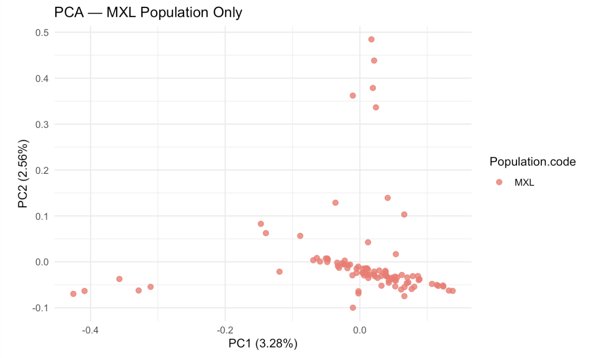

# Genomics Portfolio Website

A professional single-page portfolio site for genomics and genome curation job applications. Built with HTML, CSS, and vanilla JavaScript — no build tools required.

## Quick start

```bash
cd ~/Projects/genomics-portfolio
python3 -m http.server 8080
```

Open [http://localhost:8080](http://localhost:8080) in your browser.

Alternatively, open `index.html` directly in a browser.

## Project structure

```
genomics-portfolio/
├── index.html       # Main page (all sections)
├── styles.css       # All styling
├── scripts.js       # Smooth scroll, mobile nav, animations
├── assets/
│   ├── cv.pdf       # Replace with your CV
│   └── images/      # Add section images here
└── README.md
```

## Replacing your CV

Replace `assets/cv.pdf` with your own CV file. Keep the filename as `cv.pdf`, or update the `href` attributes on the Download CV buttons in `index.html`.

## Placeholder checklist

Use your editor's find-and-replace to swap each placeholder. Search for the bracket labels below.

| Placeholder | Location |
|-------------|----------|
| `[INSERT NAME HERE]` | `<title>`, site logo, hero name, footer copyright (4 places) |
| `[INSERT TITLE HERE]` | Hero section |
| `[INSERT TAGLINE HERE]` | Hero section |
| `[INSERT INTRO TEXT HERE]` | One per section (7 sections) |
| `[INSERT SUB-HEADER HERE]` | Inside content cards (2 per section) |
| `[INSERT TEXT HERE]` | Inside content cards (2 per section) |
| `[INSERT IMAGE HERE]` | Image placeholder divs (1 per section) |
| `[INSERT CAPTION HERE]` | Figure captions (1 per section) |
| `[INSERT EMAIL HERE]` | Footer email link and `mailto:` href |
| `[INSERT PHONE HERE]` | Footer phone link and `tel:` href |
| `[INSERT LINKEDIN URL HERE]` | Footer LinkedIn link and display text |
| `[INSERT LOCATION HERE]` | Footer location |

## Adding images

1. Save your image to `assets/images/` (e.g. `assets/images/lab-work.png`).
2. In `index.html`, replace the placeholder `<div>` with:

```html

```

## Sections

1. About Me (`#about`)
2. Education (`#education`)
3. Application of Genomic Knowledge (`#genomic-knowledge`)
4. NPAAC Standards (`#npaac-standards`)
5. Genome Curation (`#genome-curation`)
6. Interpersonal Skills (`#interpersonal-skills`)
7. Professional Engagement (`#professional-engagement`)

## Customisation

- **Colours:** Edit CSS custom properties at the top of `styles.css`
- **Font:** Currently Inter via Google Fonts; change the `<link>` in `index.html` and `--font-family` in `styles.css`
- **Section content:** Each section is clearly commented in `index.html`
